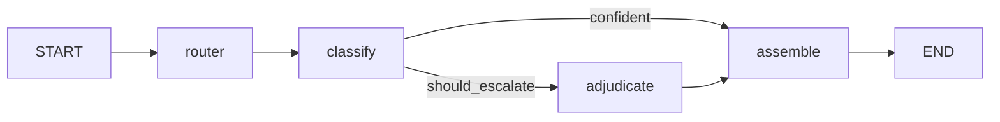

# ADR-001: Agent orchestration framework and LLM provider layer

- **Status:** Accepted (spike pending live validation, see issue #1)
- **Date:** 2026-10-13
- **Deciders:** Rachad Chazbek

## Context

SCYiBL is being rebuilt from a single RoBERTa classifier (2022) into a multi-agent service that
classifies journaling sentences into eight therapeutic-framework categories. It escalates
uncertain cases to a stronger model and flags risk signals (epic #15). Constraints:

- Structured (schema-validated) output for 8 multi-label categories
- Provider chosen by configuration; Cohere first (scenario A: no Canadian processing requirement for now)
- Escalation rules driven by `config/agents.yaml`
- Unit-testable without network or API keys
- Tracing and cost hooks; sensitive (mental-health) text must not leak into logs or third-party tooling by default

## Options considered

| Option | Verdict |
|---|---|
| A. Custom orchestrator + own `LLMClient` + Cohere SDK | Simplest for today's 4-step flow |
| B. Pydantic AI | Supports Cohere, but structured-output, embed and rerank coverage for Cohere was unclear in its docs |
| C. LiteLLM | One API for every provider, but a large dependency that sees every key; PyPI compromise of 1.82.7–1.82.8 on 2026-03-24 |
| **D. LangGraph** | **Chosen**: explicit graph, parallel branches, checkpoints, `interrupt()` for human review, room to grow into tool-using agents and multi-turn memory |

## Decision

1. **Orchestration: LangGraph** (`StateGraph`). Nodes are thin wrappers around plain async agent
   functions (`scyibl/agents/`). Escalation is a conditional edge backed by the pure function
   `scyibl.escalation.should_escalate`.
2. **Provider calls: our own `LLMClient` protocol** (`scyibl/llm/base.py`) with a Cohere adapter
   on the official SDK (API v2): `chat_json` (JSON-Schema response format), `embed`, `rerank`.
   **No `langchain-cohere`**: we keep Cohere's native structured output, and agents never
   depend on LangChain types.
3. **Models are `provider/model` strings** in config. `ProviderRouter` dispatches to the adapter
   of each provider. Adding a provider means writing one adapter and changing config.
4. **Privacy defaults:** no persistent checkpointer (`graph.checkpointer: none`; `memory` is
   RAM-only); LangSmith tracing off by default (#13).

Retrieval (#6) and the parallel safety branch (#8) are added in #18.

## Consequences

- (+) Agents and escalation logic are testable with `FakeLLMClient`; CI never needs a key.
- (+) Human-in-the-loop, checkpoints and agent loops are available when needed.
- (−) More abstraction than a 4-step pipeline strictly needs; `langgraph` + `langchain-core` are added as dependencies.
- (−) Each new provider needs an adapter (~100 lines) rather than being free via a gateway.
- Cohere structured-output limits shape the schema (`scyibl/schema.py`): range checks happen in Pydantic, not in the schema sent to the model.
- Cohere fine-tuning is deprecated, so fine-tuning (#12) targets an open encoder.

## Validation (spike)

`scripts/spike_cohere.py` runs 10 **invented** sentences through the graph with Cohere, plus one
embed and one rerank check. It reports schema validity, escalations, latency and tokens.
Results are recorded in issue #1.
